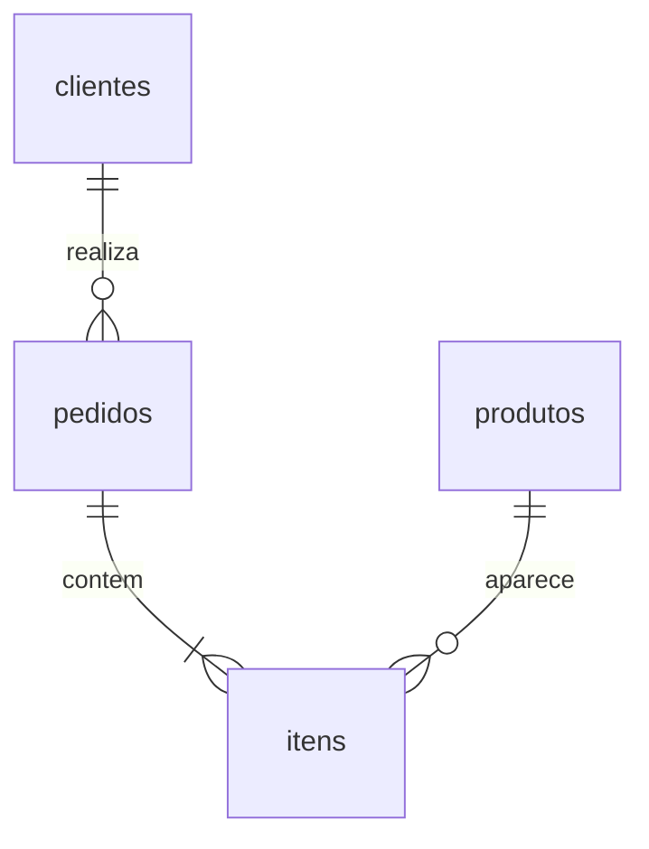

# E-commerce: perguntas de negocio com SQL

**SQLite · JOIN · GROUP BY · CTE · Modelagem relacional**

Projeto de portfolio que transforma pedidos e itens em indicadores comerciais.
Base **ficticia**, sem informacoes de pessoas reais: 30 clientes, 3 produtos, 120 pedidos e 240 itens de 2025.

## Executar

Python 3.10+, sem instalar pacotes:

```bash
python executar.py
```

O programa cria um SQLite em memoria, verifica chaves estrangeiras e gera [RESULTADOS.md](RESULTADOS.md).
Para estudar em outro editor SQLite, execute `schema.sql`, `seed.sql` e depois `consultas.sql`, nessa ordem, em um banco vazio.

## Modelo de dados



| Tabela | Campos e significado |
|---|---|
| clientes | id: chave; estado: UF ficticia |
| produtos | id, nome, categoria, preco_centavos: preco de catalogo |
| pedidos | id, cliente_id, data, entrega (nula em cancelamentos), status |
| itens | pedido_id + produto_id: chave composta; quantidade; preco_centavos: preco historico unitario |

Datas usam AAAA-MM-DD; dinheiro e armazenado em centavos inteiros.
O relacionamento pedido–itens evita repetir dados do cliente e permite varios produtos por pedido.

## Perguntas respondidas

1. Qual a receita e o volume de pedidos por mes?
2. Quais categorias concentram a receita?
3. Quantos compradores fizeram pelo menos dois pedidos entregues?
4. Qual o prazo medio de entrega por estado?
5. Qual o ticket medio por pedido?

## Cuidados analiticos

Apenas pedidos entregues compoem receita, ticket e recorrencia. A recorrencia usa compradores, nao todos os clientes cadastrados, como denominador.
Prazos sao calculados no nivel do pedido; ticket usa uma CTE que soma itens antes da media, evitando duplicacoes por JOIN.
Os dados foram construidos de forma deterministica para estudo; nao permitem inferencias sobre clientes reais, sazonalidade, lucro ou causalidade.

Proximo passo: incluir custos, data prometida e coortes de recompra.

Licenca: MIT.
